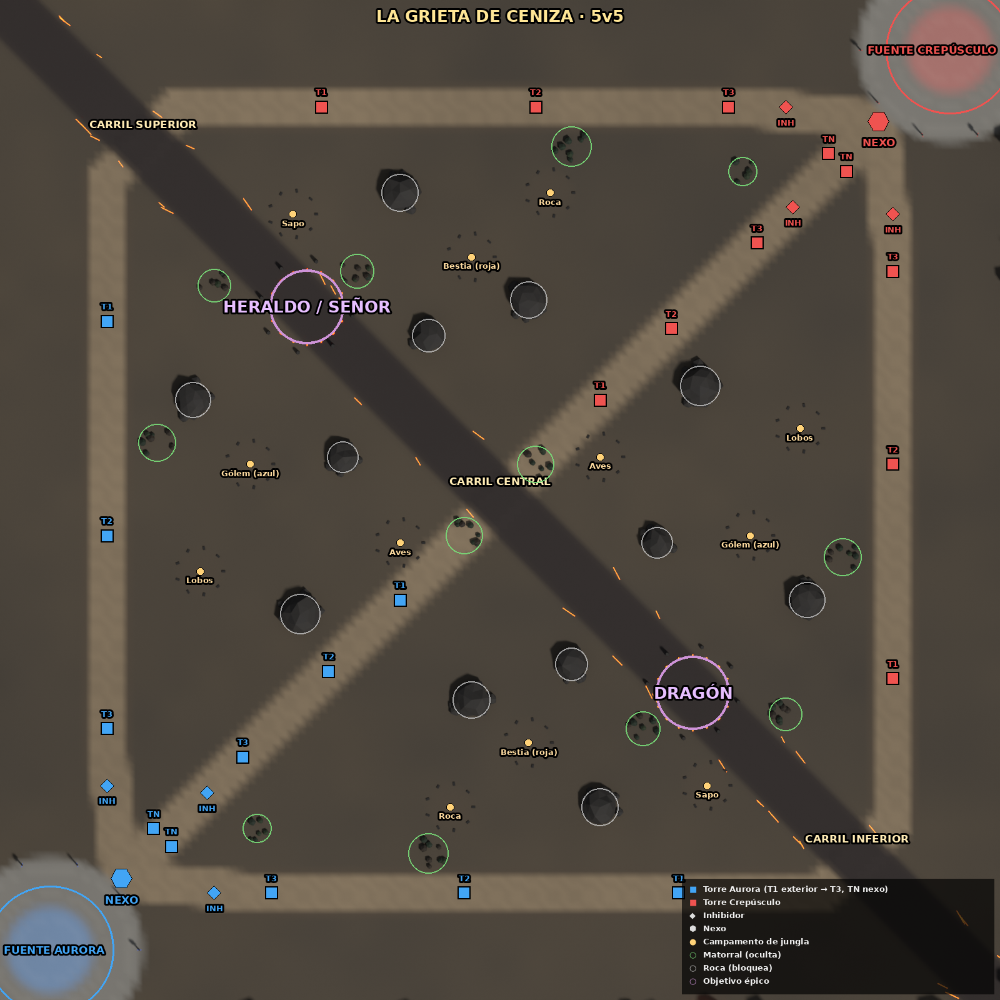
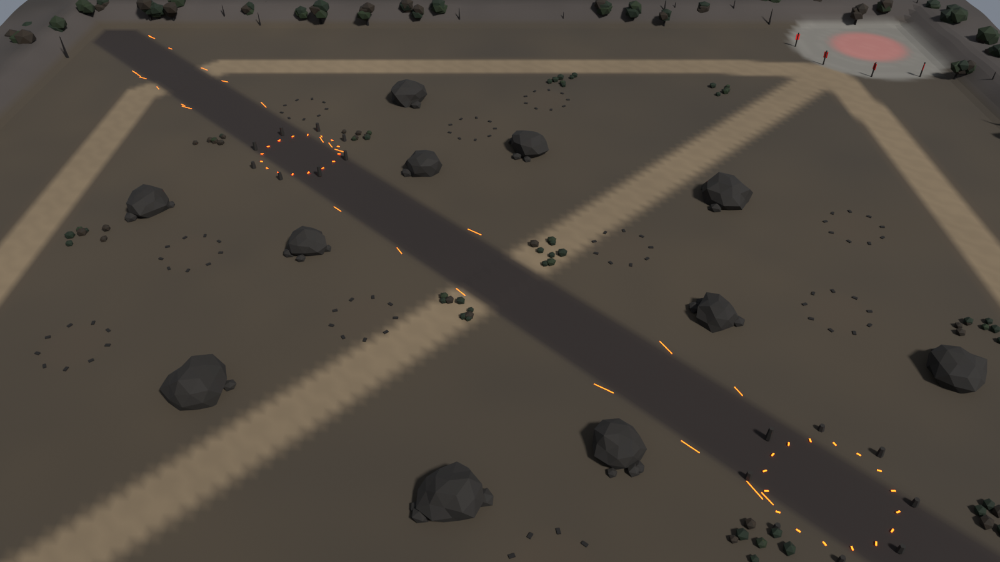
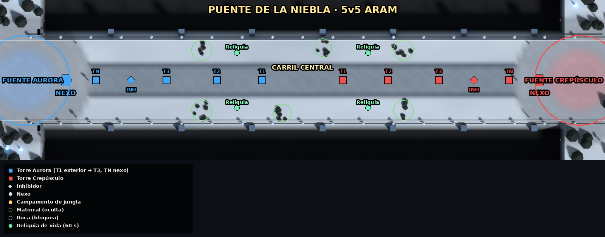
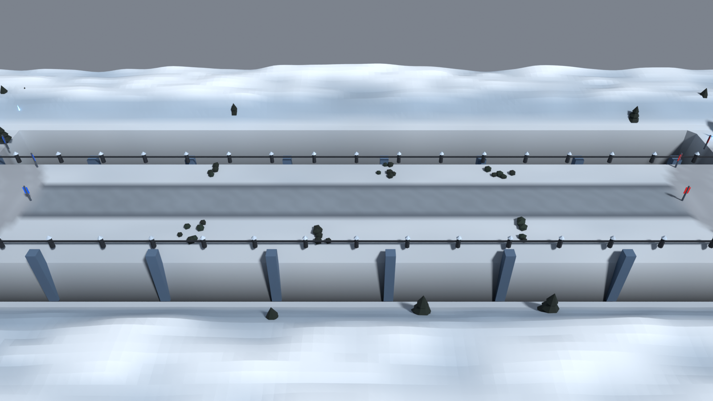
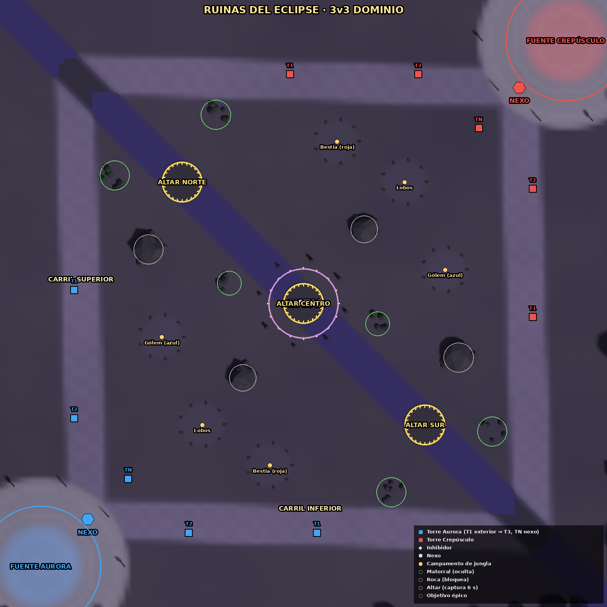
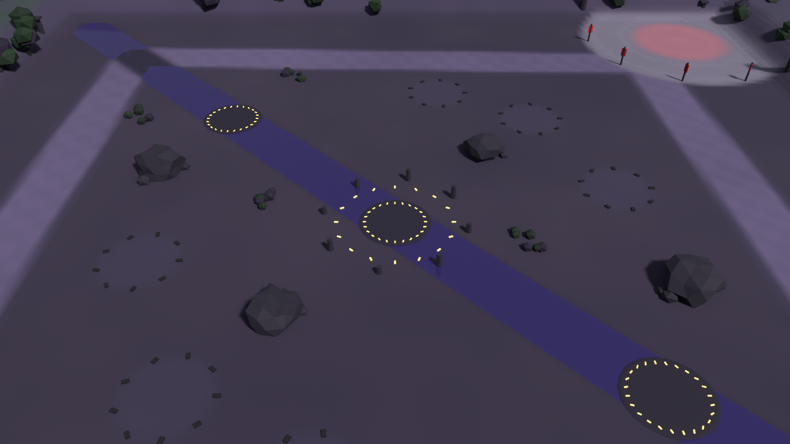

# Diseño de niveles — Coronas de Ceniza

Los tres mapas son a la vez:
- **Simulación** (`game/src/maps.js`): la verdad jugable (posiciones, colisiones y reglas).
- **Escenario 3D**, modelado en Blender por script a partir de esa misma geometría (`tools/blender/build_maps.py` ← `assets/data/map_layouts.json`).

| Mapa | Documento | Plano anotado | Perspectiva | Escena Blender | Modelo del juego |
|---|---|---|---|---|---|
| La Grieta de Ceniza (5v5) | [grieta_ceniza.md](grieta_ceniza.md) |  |  | `art/blender/maps/grieta_ceniza.blend` | `game/assets/models/map_grieta_ceniza.glb` |
| Puente de la Niebla (ARAM) | [puente_niebla.md](puente_niebla.md) |  |  | `art/blender/maps/puente_niebla.blend` | `game/assets/models/map_puente_niebla.glb` |
| Ruinas del Eclipse (3v3) | [ruinas_eclipse.md](ruinas_eclipse.md) |  |  | `art/blender/maps/ruinas_eclipse.blend` | `game/assets/models/map_ruinas_eclipse.glb` |

## Cómo regenerar (tras cambiar `game/src/maps.js`)
```bash
node game/tools/export_maps.mjs                 # geometría de la simulación -> assets/data/map_layouts.json
python3 tools/blender/build_maps.py <id>        # Blender: .blend + .glb + renders (o "all"; mejor uno a uno, ~2 min cada uno)
python3 tools/blender/annotate_maps.py          # planos anotados
python3 tools/blender/build_structures.py       # torre, inhibidor, nexo, fuente y guardián
cd game && npx gltf-transform optimize assets/models/src/map_<id>.glb assets/models/map_<id>.glb --compress meshopt --simplify false
node tools/bundle.mjs
```

## Reglas de construcción
- **Todo lo jugable está a z = 0.** El relieve (acantilados, abismo, lecho del río a −0,12 m) es decorativo y queda fuera de la zona en la que la simulación deja moverse.
- Las rocas y los matorrales del escenario coinciden 1:1 con los obstáculos y matorrales de la simulación. Si se mueven en `maps.js`, hay que regenerar.
- **Rendimiento del escenario:**

  | Mapa | Triángulos | Peso optimizado | Llamadas de dibujo |
  |---|---|---|---|
  | Grieta | 83 k | 0,7 MB | 3–4 |
  | Puente | 34 k | 0,36 MB | 3–4 |
  | Ruinas | 66 k | 0,57 MB | 3–4 |

  Todas usan colores por vértice y 1 material por capa: terreno, decorado, brillo y agua.
