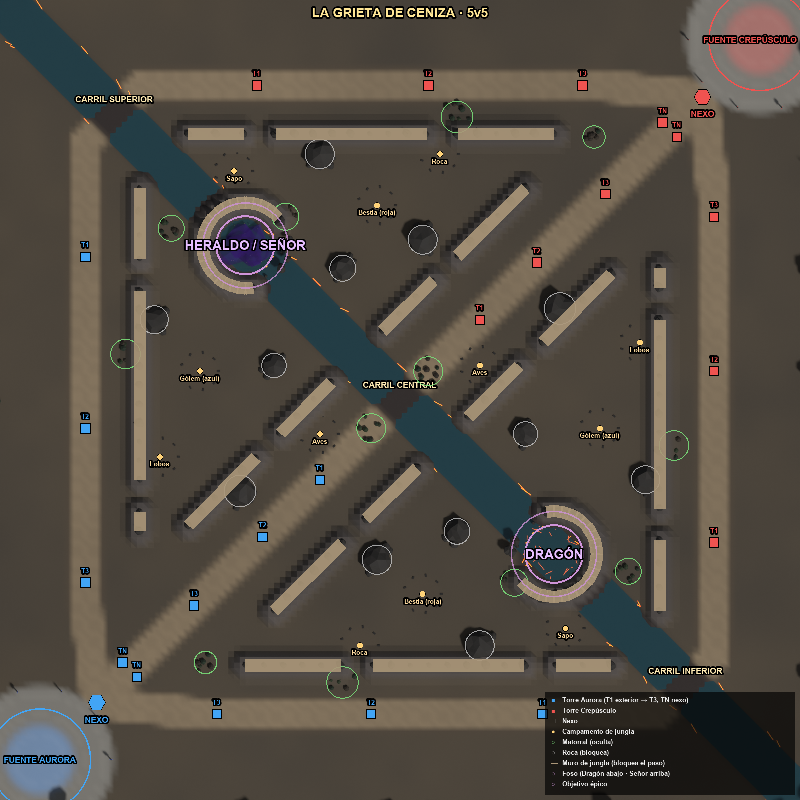
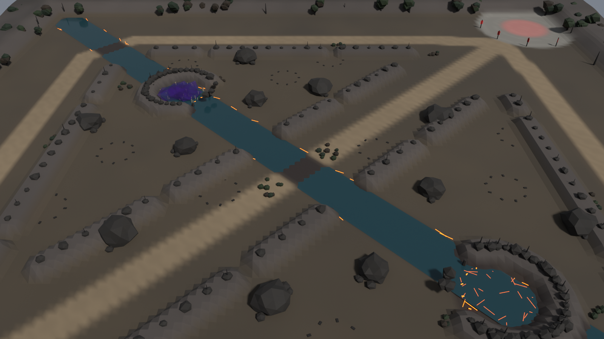

# La Grieta de Ceniza — documento de diseño de nivel

## Overview
Mapa principal 5v5 de 14 000 × 14 000 u con las reglas de **Wild Rift**: 3 torres por carril y sin inhibidores. Las ruinas de una capital élfica calcinada están cruzadas en diagonal por un río de agua oscura con grietas de lava. Tiene tres carriles, cuatro cuadrantes de jungla cerrados por muros (crestas de 1,6 m) y dos fosos épicos hundidos en el río: el del Dragón abajo y el del Señor (y el Heraldo) arriba.

## Player Fantasy
Una guerra en tres frentes sobre un reino en cenizas. Cada pelea en el río por el Dragón o el Señor se ve venir y se siente decisiva.

## Detailed Rules (disposición)
| Elemento | Posición (Aurora; Crepúsculo = reflejo (W−x, H−y)) | Notas |
|---|---|---|
| Fuente / Nexo | (700, 13300) / (1700, 12300) | Fuente: cura un 8%/s y su láser expulsa a los enemigos (radio 900) |
| Carril superior | Nexo → (1500, 10500) → (1500, 2500) → esquina → (12300, 1700) | 21 036 u; 61 s a pie; los súbditos llegan al centro en ~33 s |
| Carril central | Diagonal de Nexo a Nexo | 14 991 u; 43 s |
| Carril inferior | Nexo → (3500, 12500) → (11500, 12500) → esquina → Nexo rival | 21 036 u; 61 s |
| Torres (por carril) | T1 exterior, T2 interior, T3 base (+ 2 TN del Nexo); **sin inhibidor** | T1 a 20–26 s de la fuente; T3 a 9–11 s. Al caer la T3, súper-súbditos en ese carril y TN atacables |
| Jungla (6 por lado) | Gólem azul (3500, 6500) · Lobos (2800, 8000) · Aves (5600, 7600) · Bestia roja (7400, 10400) · Roca (6300, 11300) · Sapo (9900, 11000) | Claro de tierra y anillo de piedras alrededor de cada campamento |
| Dragón Elemental | Foso inferior del río (9700, 9700), r = 750, boca hacia el río central | 6:00 y 4:30 tras morir; foso hundido −0,2 m con grietas de lava emisivas; los 4 tipos cambian el terreno |
| Heraldo / Señor | Foso superior del río (4300, 4300), r = 750, boca hacia el río central | Heraldo 6:00 → 11:00; Señor desde 11:00; foso con huesos y niebla morada |
| Muros (11 polilíneas por lado, `wr` 110) | x = 2450 (sup./jungla, huecos y 4540–5100 y 8400–8960) · x + y = 12500 (jungla sup./mid, hueco en (4700, 7800)) · x + y = 15500 (jungla inf./mid, hueco en (6200, 9300)) · y = 11650 (jungla/inf., huecos x 5970–6530 y 9170–9730) · arco del foso | Crestas de +1,6 m con rocas y árboles muertos; 320 círculos de colisión; pasos sobre el río de 1273 u; bocas de foso de 1300 u |
| Rocas | 12 (6 por lado) | Bloquean el paso (obstáculo real de la simulación) |
| Matorrales | 12 (6 por lado) | Ocultan a quien está dentro; en las entradas de jungla y en el río |

**Rutas de emboscada (gank):** desde cada bonus el jungla alcanza su carril lateral en ~10 s y el central en ~8 s. Los matorrales del río ((6500, 7500) y su reflejo) cubren las dos entradas a mitad de carril.

**Ritmo (reglas Wild Rift, `rules` en `maps.js`):**
- Primera oleada a 1:05 (sale de la base; llega al centro del carril a ~1:35). Valor pendiente de verificar contra Riot: ver `design/gdd/match-flow.md`.
- Dragón y Heraldo a las 6:00; Señor a las 11:00 (el Heraldo se retira si sigue vivo).
- La partida dura 25–35 min (medido en partidas de bots: 27–39 min).

**Navegación:** los campeones y mascotas rodean los muros con `game/src/nav.js` (rejilla de 200 u, A\* octil) solo cuando la recta al destino choca. Los muros **no bloquean la visión** (limitación documentada en `maps.md`).

## Formulas
- Tiempo de recorrido = longitud / velocidad (345 u/s campeón, 325 u/s súbdito).
- Simetría por reflexión puntual: P_Crepúsculo = (14000 − x, 14000 − y). Ninguna posición favorece a un equipo.

## Edge Cases
- Las rocas temporales (pilares de Brannoc) y las de Forja (Dragón de Forja) se añaden en el juego, no en el `.glb`.
- Los matorrales nuevos (Dragón de Ceniza o de Raíz) los genera el juego sobre el escenario.

## Dependencies
`design/gdd/maps.md` (reglas), `game/src/maps.js` (geometría), `tools/blender/build_maps.py` (escenario).

## Tuning Knobs
Posiciones en `maps.js` (después: `export_maps.mjs` y `build_maps.py`), paleta `PAL['grieta_ceniza']` y densidad del decorado (`scatter_border`).

## Arte y ambiente
- Paleta de ceniza (pardos y grises cálidos), losas en los carriles y río de agua oscura (`water = (36, 70, 78)`, material `Agua`) sobre lecho de basalto con grietas de lava emisivas.
- Muros de jungla como crestas de basalto (+1,6 m, color `cliff`) con rocas y árboles muertos encima; fosos hundidos −0,2 m con anillo de rocas; el del Dragón con grietas de lava, el del Señor con huesos y niebla morada (material `Niebla`, alfa 0,35).
- Acantilados de 2–5 m en el borde, con árboles muertos y frondosos, y charcas de lava fuera del área de juego.
- Estandartes del color de cada equipo rodean las bases.

## Acceptance Criteria
- Los obstáculos y matorrales del `.glb` coinciden con los de la simulación (se generan del mismo JSON).
- Ningún elemento decorativo supera 0,3 m de altura dentro de la zona jugable, salvo rocas, estructuras, matorrales y los muros (que la simulación también bloquea).
- 60 fps con GPU integrada (91 k triángulos de escenario, 0,86 MB optimizado).
