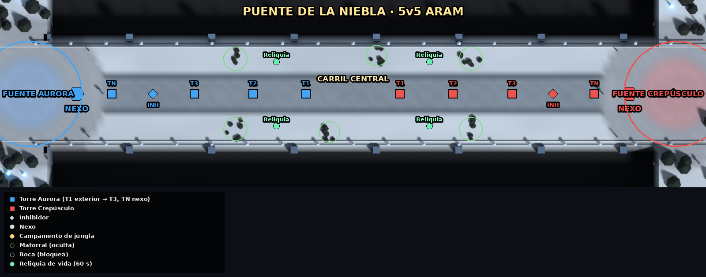
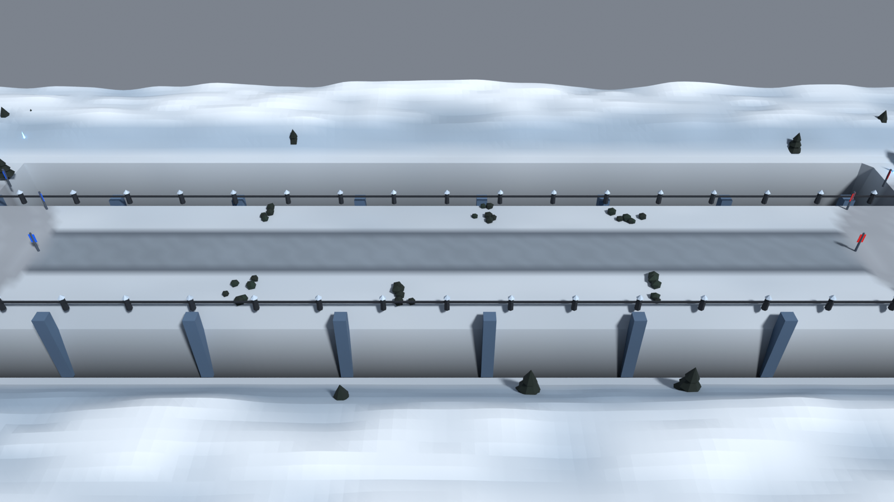

# Puente de la Niebla — documento de diseño de nivel

## Overview
Mapa ARAM 5v5 de 12 000 × 3200 u. Es un único puente de piedra helada (zona jugable y = 800–2400) suspendido sobre un abismo, entre dos fortalezas en tierra firme.

## Player Fantasy
Pelea continua y sin escapatoria: no hay jungla ni rutas alternativas, solo el puente.

## Detailed Rules (disposición)
| Elemento | Posición | Notas |
|---|---|---|
| Fuentes / Nexos | (500, 1600) / (1300, 1600) y reflejo | La fuente no cura (regla ARAM) |
| Carril | (1300, 1600) → (10700, 1600) | 9 400 u; 27 s de Nexo a Nexo |
| Torres por equipo | T1 (5200), T2 (4300), T3 (3300), TN (1900) | Vida ×0,7 en ARAM. T1 a 14 s de la fuente |
| Inhibidor | (2600, 1600) | Reaparece a los 5 min |
| Reliquias de vida | (4700, 1050), (4700, 2150) y reflejos | Aparecen cada 60 s y curan 90 + 6 × nivel |
| Matorrales | 6, en los bordes del puente junto a las T1 y T2 | Emboscadas y esquivas de habilidades |
| Barandillas | Pilares cada 600 u en los bordes (decorativos) | El límite real es el borde de la zona jugable (y = 800 / 2400) |

**Ritmo:** primera pelea a los ~0:45. Asedio en grupo desde el minuto 9. Duración de 15–22 min (medido: 16–27 min).

## Formulas
Reflexión puntual: P_Crepúsculo = (12000 − x, 3200 − y).

## Edge Cases
Los desplazamientos hacia el abismo se frenan en el borde del puente (el juego limita la posición a la zona jugable).

## Dependencies
`design/gdd/maps.md` §Mapa 2, `game/src/maps.js`, `tools/blender/build_maps.py`.

## Tuning Knobs
`towerHpMult`, `siegeMinute`, posición de las reliquias y paleta `PAL['puente_niebla']`.

## Arte y ambiente
- Tablero de losas grises sobre nieve, con barandilla de pilares nevados.
- Abismo de 9 m con arcos de soporte del puente.
- Pinos nevados y cristales de hielo emisivos en los acantilados de los extremos.

## Acceptance Criteria
- Ningún campeón puede salir del tablero.
- La lectura del abismo es inequívoca desde la cámara del juego.
- 34 k triángulos de escenario.
