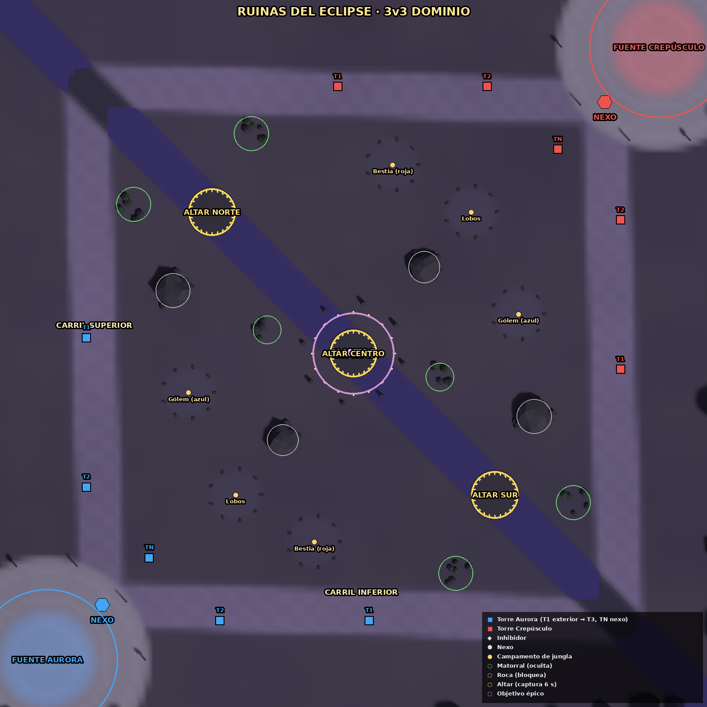
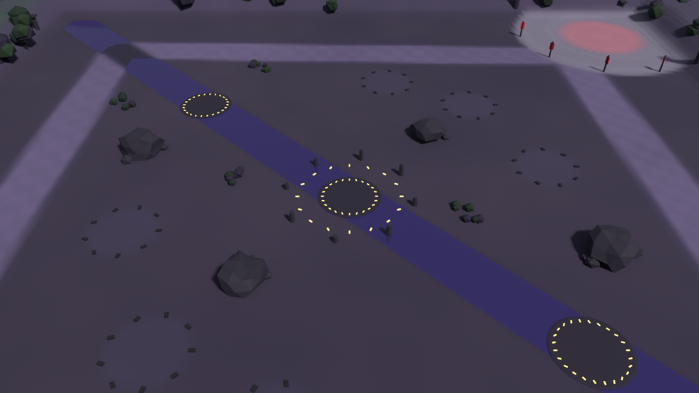

# Ruinas del Eclipse — documento de diseño de nivel

## Overview
Mapa de dominio 3v3 de 9000 × 9000 u. Un templo bajo un eclipse perpetuo, con dos carriles por los bordes, un río violeta en diagonal y tres altares sobre él.

## Player Fantasy
Control de zonas: estar en el sitio correcto vale más que ganar una pelea.

## Detailed Rules (disposición)
| Elemento | Posición (Aurora; Crepúsculo = reflejo) | Notas |
|---|---|---|
| Fuente / Nexo | (600, 8400) / (1300, 7700) | — |
| Carriles | Superior por la esquina (1100, 1100); inferior por (7900, 7900) | 13 206 u cada uno; 38 s |
| Torres | T1 y T2 en cada carril + 1 TN | Sin inhibidores |
| Altares | Norte (2700, 2700) · Centro (4500, 4500) · Sur (6300, 6300) | Equidistantes (16–18 s desde ambas fuentes). Captura en 6 s sin enemigos dentro; 1 punto cada 2,5 s por altar |
| Avatar del Eclipse | Altar Centro, desde el minuto 10 (cada 4 min) | Duplica los puntos 30 s |
| Jungla (3 por lado) | Gólem (2400, 5000) · Lobos (3000, 6300) · Bestia (4000, 6900) | — |
| Rocas / matorrales | 4 / 6 | Cubren los accesos laterales a los altares |

**Ritmo:** primeras capturas a los ~0:25. Victoria a los 500 puntos, con una duración de 12–18 min (medido: 11–13 min).

## Formulas
Puntos por segundo = 0,4 × altares controlados (× 2 con el Avatar).

## Edge Cases
Si los dos equipos llegan a 500 en el mismo tick, gana el que controla más altares.

## Dependencies
`design/gdd/maps.md` §Mapa 3, `game/src/maps.js`, `tools/blender/build_maps.py`.

## Tuning Knobs
Posición de los altares, `winPoints` e intervalo de puntos (2,5 s).

## Arte y ambiente
- Suelo de musgo violeta y losas en damero en los carriles.
- Plataformas de altar con anillo de runas doradas emisivas y agua violeta translúcida en el río.
- Columnata en ruinas alrededor del templo, con vegetación verde y violeta.

## Acceptance Criteria
- Los tres altares son visibles y legibles desde la cámara.
- El color del anillo del altar cambia al equipo que lo controla (en el juego).
- 66 k triángulos de escenario.
